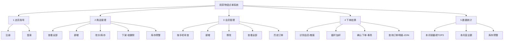
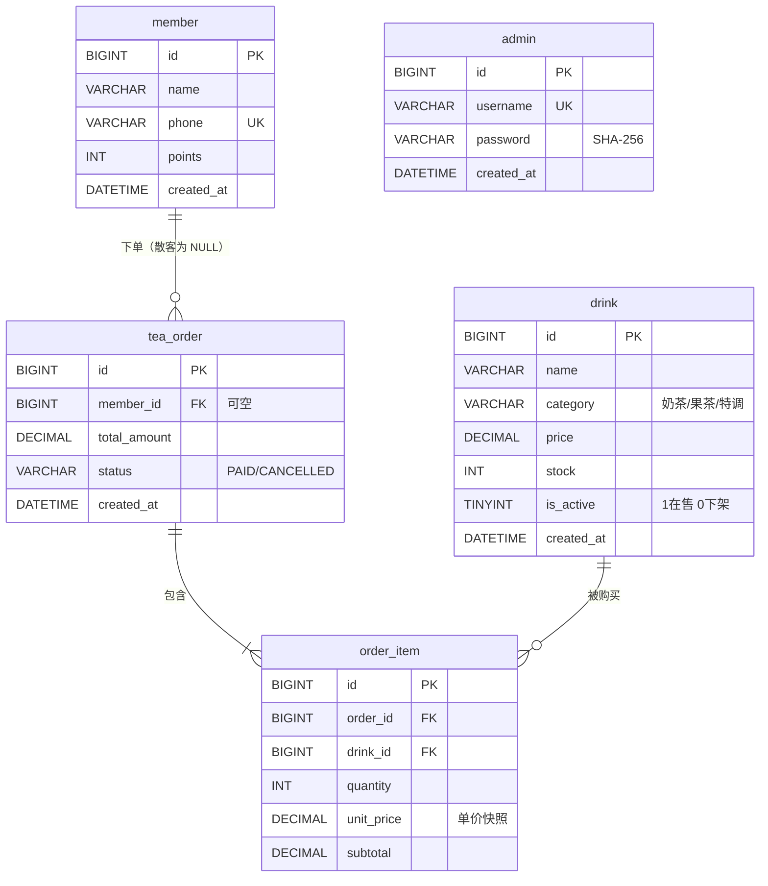
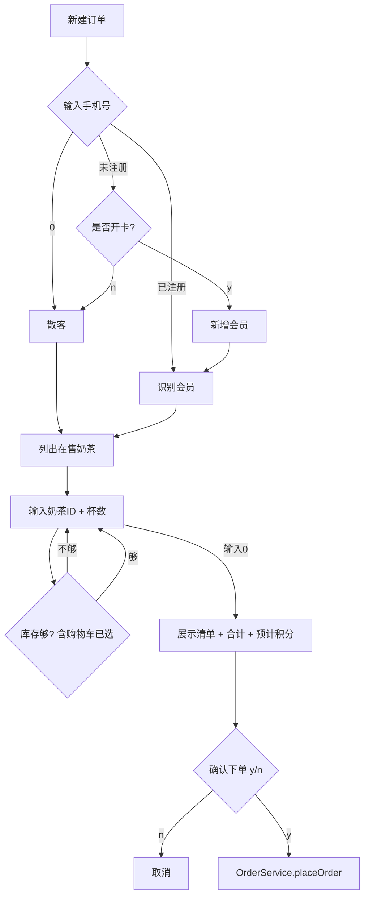

# 奶茶物语 · 设计文档

## 1. 项目背景

大学城一家奶茶店长期用纸条记单：打烊对账慢、不知道哪款卖得好、会员积分靠手写。本项目做一个控制台版点单系统：店员快速下单、自动算总价、给会员累计积分；老板一键查看本月销量榜、营业额和库存预警。

## 2. 角色与用户故事

| 角色 | 诉求 |
| --- | --- |
| 店员（admin） | 快速登录、快速下单、查会员、查库存 |
| 会员（member） | 报手机号自动累计积分 |
| 老板（admin） | 看销量榜、营业额、库存预警 |

店员与老板共用 `admin` 表，所有登录用户都能使用全部功能（未引入 RBAC）。

| 编号 | 用户故事 | 验收标准 |
| --- | --- | --- |
| US-01 | 店员快速登录 | 用户名 + 密码登录；失败统一提示"用户名或密码错误" |
| US-02 | 一单多杯下单 | 一笔订单含 1~N 种奶茶，自动计算合计并扣库存 |
| US-03 | 会员积分自动累加 | 输入手机号下单，积分 += 总金额（满 1 元加 1 分） |
| US-04 | 本月销量榜 | 按杯数倒序取 TOP 3，显示奶茶名 + 杯数 + 营业额 |
| US-05 | 库存预警 | 库存 < 10 的在售奶茶高亮，并可单独查看清单 |
| US-06 | 散客下单 | 手机号输入 0 为散客，`member_id` 为 NULL，不累计积分 |
| US-07 | 查订单明细 | 输入订单号显示会员、时间、总额及每杯明细 |
| US-08 | 软删除商品 | 下架后 `is_active = 0`，历史订单仍能看到名字和当时价格 |

## 3. 功能模块树



## 4. 架构

```
Main（表现层：菜单、输入输出、异常提示）
  └── service（业务层：参数校验、业务规则、事务边界）
        └── dao（数据访问层：只写 SQL，PreparedStatement）
              └── util.DbUtil → MySQL
entity：贯穿各层的数据载体
```

- **DAO 只管 SQL**，不做业务判断；需要参与事务的方法（`insertWithConn`、`decrementStockWithConn`、`addPointsWithConn` 等）接收外部传入的 `Connection`。
- **Service 负责规则与事务**：校验失败抛 `BusinessException`，Main 捕获后只显示中文提示。
- **DAO 异常**统一包装为 `DaoException`，并能识别 MySQL 1062（唯一键冲突），用于并发注册 / 并发开卡时兜底。

## 5. ER 图



设计要点：

- 订单表命名为 `tea_order`，避开 MySQL 保留字 `order`。
- `order_item.unit_price` 保存下单时的价格快照，奶茶改价不影响历史订单。
- 商品下架是软删除，外键关系始终有效，历史订单 JOIN 不会丢名字。
- 索引：`admin.username`、`member.phone` 唯一；`drink.category`、`drink.is_active`、`tea_order.member_id`、`tea_order.created_at`、`order_item.order_id`、`order_item.drink_id` 普通索引，分别服务于登录、查会员、商品列表、会员订单、按月统计和明细 JOIN。
- 金额字段 `DECIMAL(6,2)` / `DECIMAL(8,2)`，Java 侧一律 `BigDecimal`。

## 6. 下单结算流程



### 6.1 `placeOrder` 事务设计

```
事务前：
  合并同款奶茶（珍珠×1 + 珍珠×2 → 珍珠×3）
  逐项校验：在售？库存够？——以数据库当前价格重建明细（单价快照）
  计算总额、校验会员存在
事务内（同一个 Connection，autoCommit = false）：
  1. INSERT tea_order               → 拿到自增订单号
  2. 批量 INSERT order_item         → addBatch / executeBatch
  3. UPDATE drink SET stock = stock - ? WHERE id = ? AND is_active = 1 AND stock >= ?
       影响行数 ≠ 1 → 抛异常（被并发抢先 / 期间被下架）
  4. UPDATE member SET points = points + ? WHERE id = ?（散客跳过）
  5. COMMIT
任何异常 → ROLLBACK → BusinessException("下单失败，已回滚：...")
finally → 恢复 autoCommit 并关闭连接
```

为什么两层校验：事务前的校验让店员尽早得到"库存不足"提示，不必开事务；事务内的条件更新是最终保证——两次检查之间库存被别的店员买走时，条件更新会失败并触发回滚，因此不会超卖。

积分用 `points = points + ?` 由数据库原子累加，而不是"先查再改"，避免并发下单时互相覆盖。

## 7. 统计 SQL

本月销量榜：

```sql
SELECT d.name, SUM(oi.quantity) AS total_qty, SUM(oi.subtotal) AS total_amount
FROM order_item oi
JOIN drink d     ON d.id = oi.drink_id
JOIN tea_order o ON o.id = oi.order_id
WHERE o.status = 'PAID'
  AND o.created_at >= DATE_FORMAT(CURDATE(), '%Y-%m-01')
  AND o.created_at <  DATE_FORMAT(CURDATE() + INTERVAL 1 MONTH, '%Y-%m-01')
GROUP BY d.id, d.name
ORDER BY total_qty DESC, total_amount DESC
LIMIT 3;
```

时间条件写成"左闭右开区间"而不是对 `created_at` 套函数，可以利用 `idx_created_at` 索引。营业额用 `COUNT(*)`、`IFNULL(SUM(total_amount), 0)`，客单价在 Java 中用 `BigDecimal.divide(..., 2, HALF_UP)` 计算，当月无订单时为 0。

## 8. 交互设计原则

- 所有选择用数字键，`0` 统一表示返回 / 完成 / 散客。
- 关键操作二次确认：确认下单、下架商品、退出登录。
- 每次操作立即反馈结果，`✓` 成功、`✗` 失败。
- 任何非法输入只提示重输，不让程序崩溃：空回车、字母、越界数字、金额超过两位小数、手机号格式错误、杯数 ≤ 0、分类不在枚举内等。

## 9. 可迭代方向

- 积分兑换、订单取消（状态置 `CANCELLED` 并回补库存、扣回积分）。
- 引入连接池（HikariCP）与 BCrypt 加盐密码。
- 店员 / 老板角色拆分（RBAC）。
- 升级为 Web 版：Servlet / Spring Boot 提供接口，`frontend/` 用 Vue3 实现点单页面。
